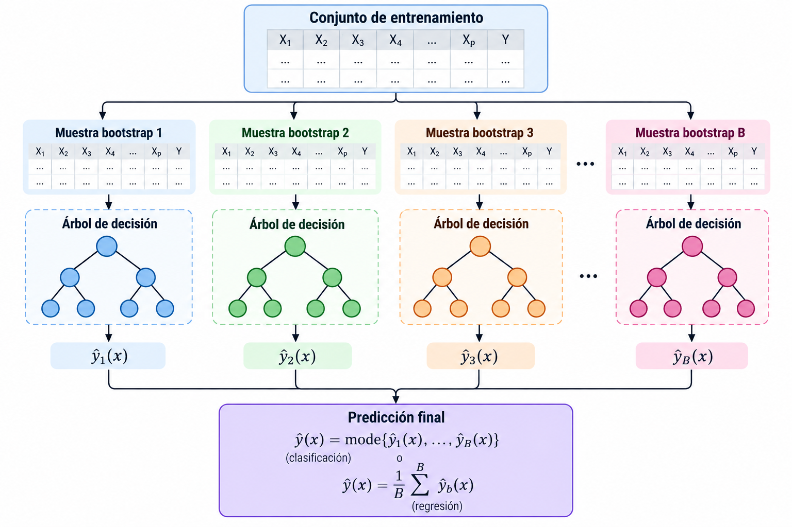
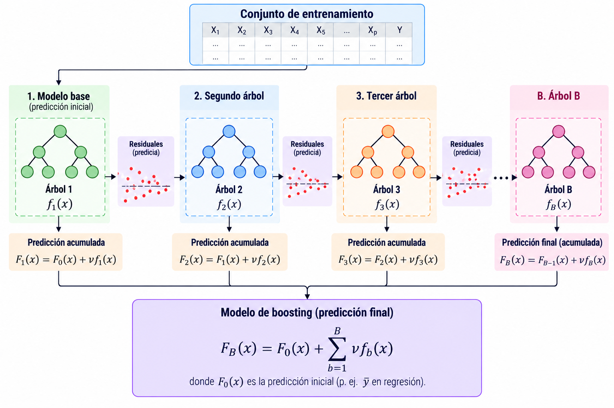

## Introducción

En la lección anterior vimos que un **árbol de decisión** divide sucesivamente el espacio de predictores.

Sin embargo, los árboles pueden tener **alta variabilidad**: pequeños cambios en los datos pueden producir árboles diferentes.

::: formula
¿Podemos obtener predicciones más estables **combinando muchos árboles**?
:::

## Una idea

Supongamos que entrenamos varios árboles con datos ligeramente diferentes.

Cada árbol produce su propia predicción:

$$\hat f_1(x),\ \hat f_2(x),\ \ldots,\ \hat f_B(x).$$

En lugar de elegir uno solo, podemos **combinar sus predicciones**.

::: formula
Un método que combina varios modelos para obtener una predicción final se denomina **método de ensamble** (*ensemble*).
:::

## ¿Cómo combinar las predicciones?

::::: columns
::: {.column width="50%"}
**Clasificación**

Cada árbol predice una clase.

| Árbol | Predicción |
|:-----:|:----------:|
|   1   |     A      |
|   2   |     B      |
|   3   |     A      |
|   4   |     A      |
|   5   |     B      |

La **votación mayoritaria** produce la clase A.
:::

::: {.column width="50%"}
**Regresión**

Cada árbol predice un valor numérico.

$$10,\quad 12,\quad 11,\quad 9,\quad 13.$$

La predicción conjunta es el promedio:

$$\hat y=\frac{10+12+11+9+13}{5}=11.$$
:::
:::::

## Bootstrap

Una forma de generar conjuntos de entrenamiento diferentes es utilizar **muestreo con reemplazo**.

A partir de un conjunto de $n$ observaciones, seleccionamos $n$ veces una observación al azar, permitiendo repeticiones.

Por ejemplo, si los datos originales son

$$D=\{1,2,3,4,5\},$$

una muestra bootstrap podría ser

$$D^{(1)}=\{2,2,4,5,1\}.$$

::: formula
Una muestra **bootstrap** tiene el mismo número de selecciones que el conjunto original, pero puede repetir observaciones y omitir otras.
:::

## Bootstrap {.unlised}

Supongamos que tenemos cinco observaciones:

$$D=\{1,2,3,4,5\}.$$

Podemos generar diferentes muestras:

|  Muestra  | Observaciones seleccionadas |
|:---------:|:----------------------------|
| $D^{(1)}$ | 2, 2, 4, 5, 1               |
| $D^{(2)}$ | 3, 1, 3, 5, 4               |
| $D^{(3)}$ | 5, 5, 2, 2, 3               |

Entrenamos **un árbol distinto** con cada muestra y combinamos sus predicciones-

## Bagging

Este procedimiento se conoce como **Bootstrap Aggregating**, o **bagging**.

1.  Generar $B$ muestras bootstrap del conjunto de entrenamiento.
2.  Entrenar un **modelo independiente** con cada muestra.
3.  Combinar las predicciones de los $B$ modelos.

Bagging es una **estrategia general de ensamble** que puede utilizarse con diferentes algoritmos de aprendizaje supervisado.

::: formula
El **bagging** busca reducir la variabilidad de las predicciones al promediar modelos entrenados con muestras diferentes.
:::

## Bagging {.unlisted}

En **regresión**, podemos combinar las predicciones de los $B$ modelos mediante el promedio:

$$\hat f_{\mathrm{bag}}(x)=\frac{1}{B}\sum_{b=1}^{B}\hat f_b(x).$$

En **clasificación**, podemos elegir la clase con mayor número de votos:

$$\hat y(x)=\operatorname{mode}\{\hat f_1(x),\ldots,\hat f_B(x)\}.$$

::: note
Algunas implementaciones calculan probabilidades promedio y después seleccionan la clase con mayor probabilidad. Esto no siempre coincide con la votación mayoritaria.
:::

## Bagging {.unlisted}

## Random Forest

**Random Forest** introduce una segunda fuente de aleatoriedad que el método bagging no toma en cuenta.

Además de entrenar cada árbol con una muestra bootstrap, en **cada división** considera solamente un subconjunto aleatorio de las variables predictoras.

::: formula
**Random Forest = bagging de árboles + selección aleatoria de variables en cada división.**
:::

## Selección aleatoria de variables

Supongamos que tenemos $p=6$ variables predictoras:

$$X_1,X_2,X_3,X_4,X_5,X_6.$$

En lugar de evaluar las seis variables en cada nodo, seleccionamos aleatoriamente $m=2$.

- **Nodo 1:** $\{X_2,X_5\}$
- **Nodo 2:** $\{X_1,X_4\}$
- **Nodo 3:** $\{X_3,X_6\}$

En cada nodo, el árbol busca el mejor corte **solamente entre las variables seleccionadas**.

## ¿Cómo se elige el corte?

La construcción de cada árbol sigue las mismas ideas de la lección anterior.

En clasificación, podemos minimizar el **índice Gini ponderado**:

$$G_{\mathrm{división}}=\frac{n_L}{n}G_L+\frac{n_R}{n}G_R.$$

En regresión, podemos buscar divisiones que reduzcan el **error cuadrático** dentro de las regiones.

::: formula
La diferencia es que Random Forest **no evalúa todas las variables en cada nodo**, sino un subconjunto aleatorio.
:::

## Construcción de Random Forest

Para cada árbol $b=1,\ldots,B$:

1.  Generar una **muestra bootstrap** de los datos de entrenamiento.
2.  Comenzar a construir un árbol de decisión.
3.  En cada nodo, seleccionar aleatoriamente $m$ de las $p$ variables.
4.  Buscar la mejor división entre esas $m$ variables.
5.  Repetir hasta satisfacer los criterios de parada.

Finalmente, **combinar las predicciones** de los árboles.

## Número de árboles

El hiperparámetro `n_estimators` determina el número de árboles $B$.

- **Pocos árboles:** las predicciones del ensamble pueden ser menos estables.
- **Más árboles:** el promedio suele estabilizarse, pero aumenta el costo computacional.

::: formula
Agregar árboles generalmente **no provoca sobreajuste de la misma manera que aumentar la profundidad de un árbol individual**; sin embargo, tampoco garantiza mejorar indefinidamente el desempeño.
:::

## Número de variables por división

El hiperparámetro `max_features` controla cuántas variables se consideran en cada nodo.

- **Valor grande:** los árboles pueden parecerse más entre sí.
- **Valor pequeño:** se introduce mayor diversidad, pero algunos cortes pueden ser menos informativos.

::: formula
Existe un equilibrio entre la **calidad de cada árbol** y la **correlación entre los árboles**.
:::

## Profundidad de los árboles

Random Forest también permite controlar la complejidad de cada árbol.

| Hiperparámetro      | Controla                             |
|:--------------------|:-------------------------------------|
| `max_depth`         | Profundidad máxima                   |
| `min_samples_split` | Mínimo de observaciones para dividir |
| `min_samples_leaf`  | Mínimo de observaciones por hoja     |
| `max_leaf_nodes`    | Número máximo de hojas               |

::: note
En Random Forest es común utilizar árboles relativamente profundos. Aun así, restringir su complejidad puede mejorar la generalización y reducir el costo computacional.
:::

## Importancia de las variables

Random Forest permite investigar qué variables contribuyen más a las predicciones.

Dos enfoques comunes son:

- **Importancia basada en reducción de impureza:** acumula las reducciones de impureza atribuibles a cada variable.
- **Importancia por permutación:** mide cuánto empeora el desempeño al alterar aleatoriamente una variable.

::: formula
Una variable importante para predecir **no necesariamente tiene una relación causal** con la respuesta.
:::

## Importancia de las variables {.unlisted}

La importancia basada en impureza puede favorecer variables continuas o con muchos posibles puntos de corte.

La importancia por permutación depende de la métrica y del conjunto de datos utilizados.

Además, cuando dos variables están fuertemente correlacionadas, la importancia puede distribuirse entre ellas.

::: note
La interpretación de las importancias requiere considerar la estructura y las relaciones entre las variables.
:::

## ¿Necesitamos escalar?

Cada árbol realiza divisiones de la forma

$$X_j<c.$$

Random Forest combina árboles que utilizan este tipo de comparaciones.

Por lo tanto, **generalmente no requiere estandarizar o normalizar** las variables predictoras.

::: formula
A diferencia de métodos basados en distancias, Random Forest normalmente **no necesita escalamiento**.
:::

## Clasificación y regresión

| Característica | Clasificación | Regresión |
|:-----------------------|:-----------------------|:-----------------------|
| Respuesta | Categoría | Valor continuo |
| División típica | Impureza Gini | Error cuadrático |
| Predicción del ensamble | Votos o probabilidades | Promedio |
| Métricas | Accuracy, precision, recall, ROC-AUC | MAE, MSE, RMSE, $R^2$ |

::: formula
Random Forest puede utilizarse tanto para **clasificación** como para **regresión**.
:::

## Ventajas

- Puede representar **relaciones no lineales** e interacciones entre variables.
- Suele reducir la variabilidad respecto a un árbol individual.
- Generalmente no necesita escalamiento.
- Funciona para clasificación y regresión.
- Permite analizar importancia de variables.

## Limitaciones

- Es **menos interpretable** que un árbol pequeño.
- Puede requerir más memoria y tiempo de entrenamiento.
- En regresión, los árboles estándar no extrapolan bien fuera del rango observado de la respuesta.
- El desempeño depende de los datos y de los hiperparámetros seleccionados.

## Boosting

Otra estrategia de aprendizaje por ensamble es **boosting**.

A diferencia de bagging, donde los modelos se entrenan independientemente, boosting construye modelos **secuencialmente**.

Cada nuevo modelo intenta mejorar las predicciones del ensamble anterior.

::: formula
**Bagging:** combina modelos entrenados independientemente.

**Boosting:** construye modelos que mejoran progresivamente las predicciones.
:::

## Boosting {.unlisted}

Supongamos que queremos predecir un valor numérico.

1. Entrenamos un primer modelo que produce una predicción.
2. Calculamos los **errores de predicción**.
3. Entrenamos otro modelo para aproximar esos errores.
4. Combinamos las predicciones de ambos modelos.
5. Repetimos el procedimiento.

En Gradient Boosting con pérdida cuadrática, cada nuevo árbol aprende a predecir los residuos del ensamble anterior.

::: formula
Los modelos se construyen **secuencialmente** para reducir progresivamente el error.
:::

## Boosting {.unlisted}

## Bagging vs. Boosting

| Característica | Bagging | Boosting |
|:---|:---|:---|
| Entrenamiento | Independiente | Secuencial |
| Objetivo principal | Reducir varianza | Reducir el error del ensamble |
| Combinación | Promedio o votación | Suma ponderada |
| Ejemplos | Random Forest | AdaBoost, Gradient Boosting |

::: note
**XGBoost, LightGBM y CatBoost** son implementaciones populares de algoritmos basados en Gradient Boosting.
:::

## Referencias

::: {#refs}
:::

## Preguntas

::::::::: columns
::: {.column width="45%"}
{width="95%"}
:::

::::::: {.column width="55%"}
:::::: vcenter
::: fragment
¿Seguro? 🤨
:::

::: fragment
Bueno...
:::

::: fragment
Pregúntale a [ChatGPT](https://chatgpt.com) pues.
:::
::::::
:::::::
:::::::::

## ¿Qué sigue?

En el siguiente notebook utilizaremos **Scikit-learn** para entrenar un Random Forest, comparar su desempeño con un árbol de decisión y analizar el efecto de `n_estimators`, `max_features` y `max_depth`.

[**Ir al notebook →**](https://colab.research.google.com/github/urendacdenisse-hub/modelado-de-datos/blob/main/notebooks/unidad-01/notebook-10.ipynb)