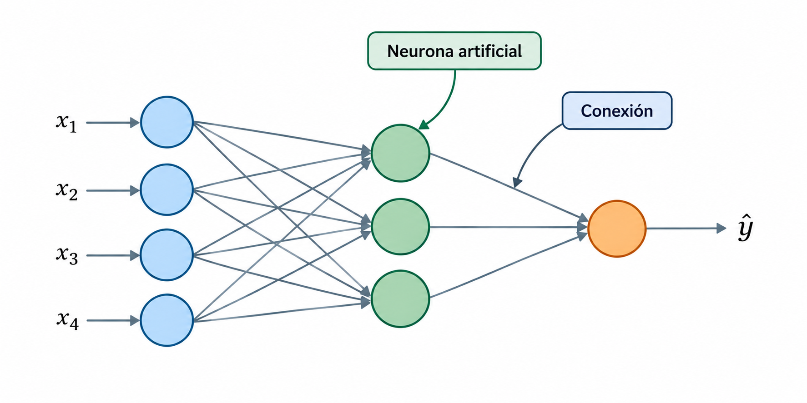
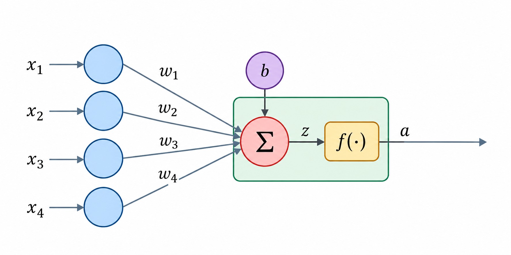
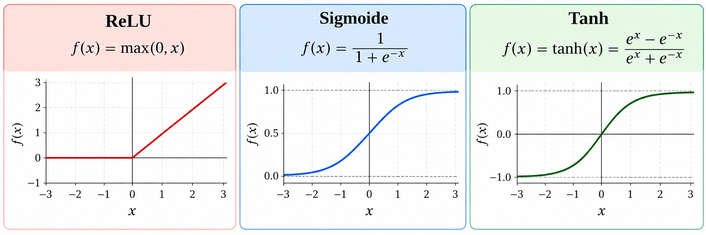
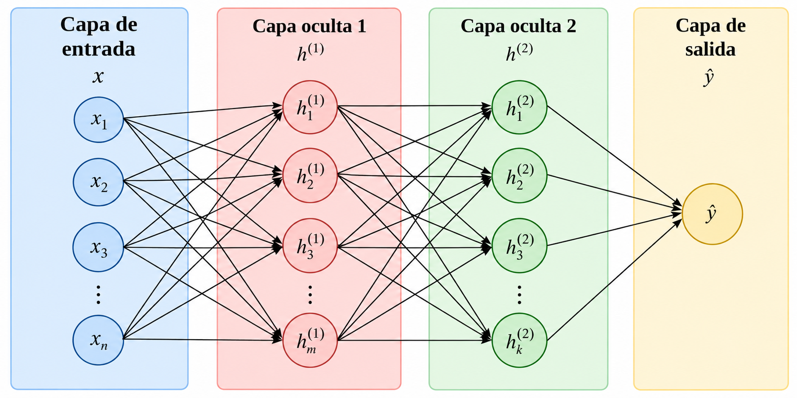
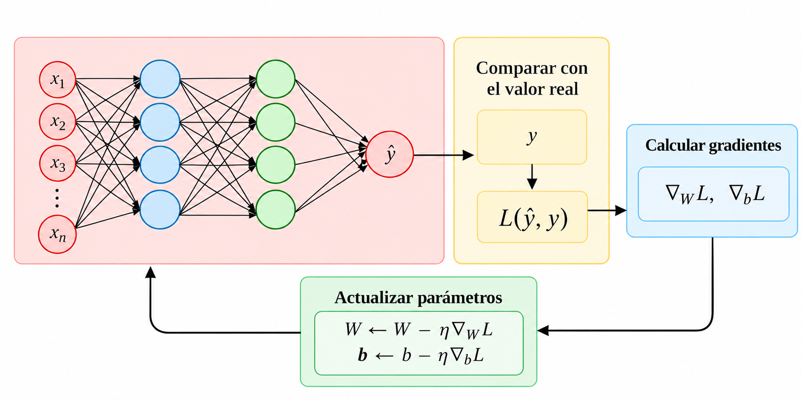

## Introducción

Las **redes neuronales artificiales (Artificial Neural Networks, ANN)** son modelos de aprendizaje automático formados por unidades de procesamiento interconectadas, llamadas **neuronas artificiales**.

Estas unidades realizan operaciones matemáticas sobre los datos y transmiten sus resultados a otras neuronas.

  

## La neurona artificial

Una **neurona artificial** recibe valores de entrada y calcula una salida.

  

## La neurona artificial {.unlisted}

Para hacerlo:

1. Multiplica cada entrada $x_i$ por un **peso** $w_i$.
2. Suma los productos y agrega un **sesgo** $b$.
3. Aplica una **función de activación** $f(\cdot)$.

La salida puede utilizarse como entrada de otras neuronas.

## Modelo matemático de una neurona

Consideremos una neurona con $n$ entradas:

$$
z = \sum_{i=1}^{n} w_i x_i + b,  \quad a = f(z)
$$

donde

:::{.incremental}
- $x_i$: valores de entrada.
- $w_i$: pesos asociados a las entradas.
- $b$: sesgo.
- $f$: función de activación.
- $a$: salida de la neurona.
:::

## Ejemplo

Supongamos que una neurona artificial recibe dos entradas:

$$x_1=2,\qquad x_2=3$$

Los pesos asociados a las entradas y el sesgo son:

$$w_1=0.5,\quad w_2=0.2,\quad b=0.1$$

La neurona utiliza la **función de activación ReLU**.

Calcula la salida de la neurona.

## Ejemplo {.unlisted}

**Solución:**

Primero, calculamos la suma ponderada de las entradas y agregamos el sesgo:

$$
z=(0.5)(2)+(0.2)(3)+0.1=1.7
$$

Después, aplicamos la función de activación ReLU:

$$
a=f(z)=\max(0,1.7)=1.7
$$

Por lo tanto, la **salida de la neurona** es:

$$
\boxed{a=1.7}
$$

## Funciones de activación

Una **función de activación** transforma el valor calculado por una neurona.

Su importancia es que permite introducir **no linealidad** en el modelo.

  

::::: columns

::: {.column width="33%"}
**ReLU:** devuelve cero para valores negativos y conserva los positivos.
:::

::: {.column width="33%"}
**Sigmoide:** transforma valores al intervalo $(0,1)$
:::

::: {.column width="33%"}
**Tanh:** transforma valores al intervalo $(-1,1)$
:::

:::::

## Ejemplo

Retomemos el resultado de nuestra neurona:

$$z=1.7$$

Comparemos la salida utilizando las tres funciones de activación:

| Función | Cálculo | Salida $a$ |
|---|---|---:|
| ReLU | $\max(0,1.7)$ | $1.7$ |
| Sigmoide | $\dfrac{1}{1+e^{-1.7}}$ | $0.846$ |
| Tanh | $\tanh(1.7)$ | $0.935$ |

**Los mismos pesos, entradas y sesgo pueden producir salidas diferentes dependiendo de la función de activación utilizada.**

## Arquitectura de una red neuronal

Una sola neurona realiza una transformación relativamente sencilla.

Podemos combinar múltiples neuronas y organizarlas en **capas** para aprender relaciones más complejas.

  

## Arquitectura de una red neuronal {.unlisted}

Una red neuronal típica contiene:

- **Capa de entrada:** recibe las variables predictoras.
- **Capas ocultas:** realizan transformaciones intermedias.
- **Capa de salida:** genera la predicción.

La estructura de la capa de salida depende del problema que queremos resolver.

| Problema | Configuración habitual |
|---|---|
| Regresión | Una neurona con activación lineal |
| Clasificación binaria | Una neurona con sigmoide |
| Clasificación multiclase | Una neurona por clase con softmax |

## Redes neuronales feedforward

En una red neuronal *feedforward*, la información fluye en **una sola dirección**, desde la capa de entrada hasta la capa de salida.

Las neuronas de cada capa reciben los resultados de la capa anterior, sin conexiones que regresen a capas previas.

- Pueden tener **una o varias capas ocultas**.
- Cada capa puede contener diferentes cantidades de neuronas.
- Se utilizan en problemas de **clasificación y regresión**.

## Otras arquitecturas de redes neuronales

Existen diferentes arquitecturas diseñadas para procesar distintos tipos de información.

| Arquitectura | Característica principal | Aplicaciones |
|---|---|---|
| **Feedforward (MLP)** | La información avanza sin ciclos. | Clasificación y regresión |
| **Convolucional (CNN)** | Utiliza filtros para identificar patrones locales. | Imágenes y visión artificial |
| **Recurrente (RNN)** | Mantiene información de pasos anteriores. | Secuencias y series temporales |
| **Transformers** | Utilizan mecanismos de atención para relacionar elementos. | Lenguaje natural y modelos generativos |

## Propagación hacia adelante

La **propagación hacia adelante (Forward Propagation)** es el proceso mediante el cual los datos atraviesan la red para generar una predicción.

En cada capa:

1. Se reciben las salidas de la capa anterior.
2. Se calculan combinaciones ponderadas.
3. Se aplican funciones de activación.
4. Se transmiten los resultados a la siguiente capa.

La última capa produce la **predicción del modelo**.

## ¿Cómo aprende una red neuronal?

Inicialmente, los pesos y sesgos de la red no representan necesariamente relaciones útiles.

Durante el entrenamiento, la red ajusta estos parámetros para **reducir los errores de predicción**.

  

## ¿Cómo aprende una red neuronal? {.unlisted}

El proceso general consiste en:

1. Generar predicciones.
2. Compararlas con los valores reales.
3. Calcular una función de pérdida.
4. Calcular los gradientes.
5. Actualizar los parámetros.
6. Repetir el procedimiento.

## Función de pérdida

Una **función de pérdida (Loss Function)** mide qué tan diferentes son las predicciones respecto a los valores reales. Su elección depende del problema.

Por ejemplo:

- **Regresión:** error cuadrático medio (MSE).
- **Clasificación binaria:** entropía cruzada binaria.
- **Clasificación multiclase:** entropía cruzada categórica.

::: {.formula}
El objetivo del entrenamiento es encontrar los parámetros que **minimicen la pérdida**.
:::

## ¿Cómo reducir la pérdida?

La pérdida depende de los **pesos y sesgos** de la red.

Podemos representarla como una función de sus parámetros:

$$
L=L(w_1,w_2,\ldots,w_m,b_1,\ldots,b_k)
$$

Para reducirla, necesitamos determinar **cómo cambia la pérdida cuando modificamos cada parámetro**.

## Derivadas parciales

Una **derivada parcial** mide cómo cambia una función respecto a una variable, manteniendo las demás constantes.

En una red neuronal:

$$
\frac{\partial L}{\partial w_i}
$$

representa cómo cambia la pérdida cuando modificamos el peso $w_i$.

::: incremental
- Un valor positivo indica que aumentar el peso incrementa localmente la pérdida.
- Un valor negativo indica que aumentar el peso reduce localmente la pérdida.
- Un valor cercano a cero indica poca sensibilidad local.
:::

## Descenso del gradiente

El **descenso del gradiente (Gradient Descent)** es un algoritmo de optimización que utiliza los gradientes para actualizar los parámetros.

Para un peso:

$$
\boxed{
w_i^{\text{nuevo}}
=
w_i^{\text{actual}}
-
\eta\frac{\partial L}{\partial w_i}
}
$$

donde:

- $L$: función de pérdida.
- $w_i$: peso que queremos actualizar.
- $\eta$: tasa de aprendizaje (*learning rate*).

La actualización se realiza en la **dirección opuesta al gradiente**, buscando reducir la pérdida.

## Descenso del gradiente {.unlisted}

Los sesgos también son parámetros que deben aprenderse durante el entrenamiento.

Su actualización sigue el mismo principio:

$$
\boxed{
b_j^{\text{nuevo}}
=
b_j^{\text{actual}}
-
\eta\frac{\partial L}{\partial b_j}
}
$$

Por lo tanto, el entrenamiento modifica **tanto los pesos como los sesgos** de la red.

## Backpropagation

La **retropropagación (Backpropagation)** es un procedimiento para calcular los gradientes de la pérdida respecto a los parámetros de una red neuronal.

Para hacerlo, utiliza la **regla de la cadena**.

1. Comienza en la capa de salida.
2. Calcula cómo depende la pérdida de sus parámetros.
3. Propaga esta información hacia las capas anteriores.
4. Obtiene los gradientes necesarios para actualizar los pesos y sesgos.

Backpropagation calcula los gradientes; el optimizador actualiza los parámetros.

## La regla de la cadena

La **regla de la cadena** permite derivar funciones que dependen de otras funciones.

Supongamos que:

$$
L=L(a),\qquad a=f(z),\qquad z=z(w)
$$

Entonces:

$$
\boxed{
\frac{\partial L}{\partial w}
=
\frac{\partial L}{\partial a}
\frac{\partial a}{\partial z}
\frac{\partial z}{\partial w}
}
$$

Esta expresión permite calcular **cómo influye un peso sobre la pérdida**, considerando las operaciones intermedias.

## Ciclo de entrenamiento

El entrenamiento combina los conceptos anteriores:

::: incremental
1. **Forward propagation:** calcular predicciones.
2. **Función de pérdida:** medir el error.
3. **Backpropagation:** calcular gradientes mediante la regla de la cadena.
4. **Optimización:** actualizar pesos y sesgos.
5. **Repetición:** continuar hasta cumplir un criterio de parada.
:::

::: fragment
El objetivo es **reducir progresivamente la pérdida durante el entrenamiento**.
:::

## Épocas de entrenamiento

Una **época (Epoch)** corresponde a una pasada completa por el conjunto de entrenamiento.

Los datos pueden procesarse en grupos más pequeños llamados **lotes (batches)**.

Durante cada lote, el modelo puede calcular predicciones, obtener gradientes y actualizar sus parámetros.

## Hiperparámetros

Al igual que otros modelos de aprendizaje automático, las redes neuronales tienen **hiperparámetros**.

Algunos ejemplos son:

::: incremental
- Número de capas ocultas.
- Número de neuronas por capa.
- Funciones de activación.
- Tasa de aprendizaje.
- Tamaño del lote.
- Número máximo de épocas.
:::

## Sobreajuste en redes neuronales

Una red neuronal con demasiada capacidad puede aprender patrones específicos de los datos de entrenamiento que no se generalizan adecuadamente.

Para reducirlo podemos utilizar:

::: incremental
- Regularización.
- Dropout.
- Detención temprana.
- Ajuste de la complejidad del modelo.
:::

## Ventajas y limitaciones

::::: columns

::: {.column width="50%"}

### Ventajas

- Aprenden relaciones no lineales complejas.
- Pueden utilizarse en clasificación y regresión.
- Permiten construir diferentes arquitecturas.
- Pueden aprovechar grandes conjuntos de entrenamiento.

:::

::: {.column width="50%"}

### Limitaciones

- Requieren ajustar varios hiperparámetros.
- Pueden ser computacionalmente costosas.
- Son sensibles al escalado de las variables.
- Su interpretación puede resultar difícil.

:::

:::::

## Referencias

::: {#refs}
:::

## Preguntas

::::::::: columns
::: {.column width="45%"}
{width="95%"}
:::

::::::: {.column width="55%"}
:::::: vcenter
::: fragment
¿Seguro? 🤨
:::

::: fragment
Bueno...
:::

::: fragment
Pregúntale a [ChatGPT](https://chatgpt.com) pues.
:::
::::::
:::::::
:::::::::

## ¿Qué sigue?

En el siguiente notebook utilizaremos **Scikit-learn** para entrenar una red neuronal artificial mediante `MLPClassifier`, evaluar su desempeño y analizar cómo influyen diferentes configuraciones de su arquitectura.

Experimentaremos con el **número de capas ocultas**, la **cantidad de neuronas por capa** y las **funciones de activación**.

[**Ir al notebook →**](https://colab.research.google.com/github/urendacdenisse-hub/modelado-de-datos/blob/main/notebooks/unidad-01/notebook-11.ipynb)