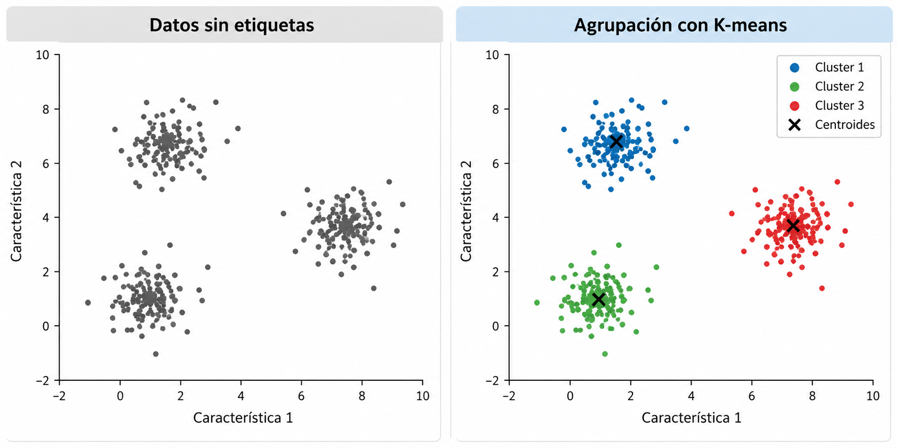
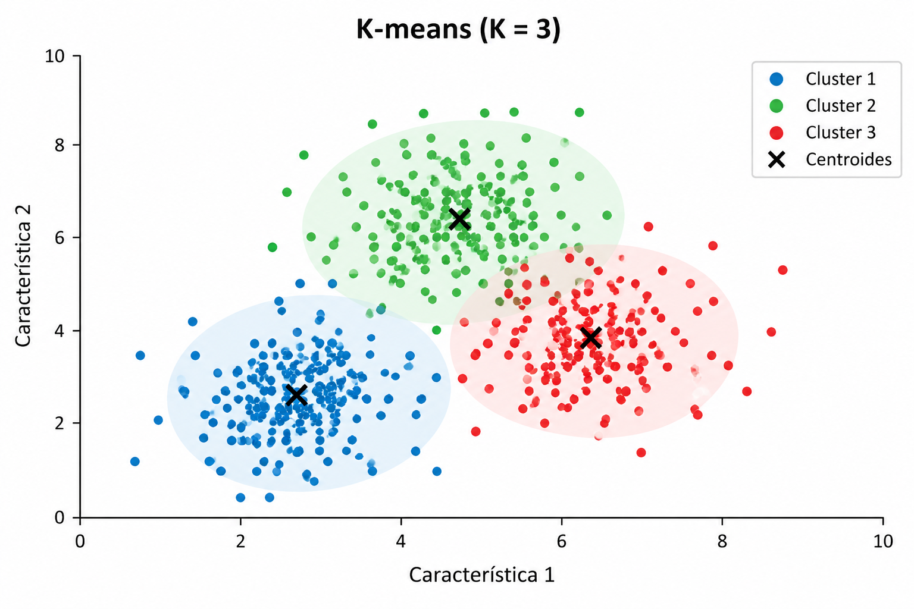
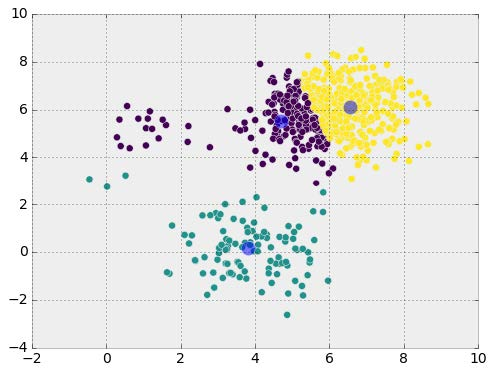
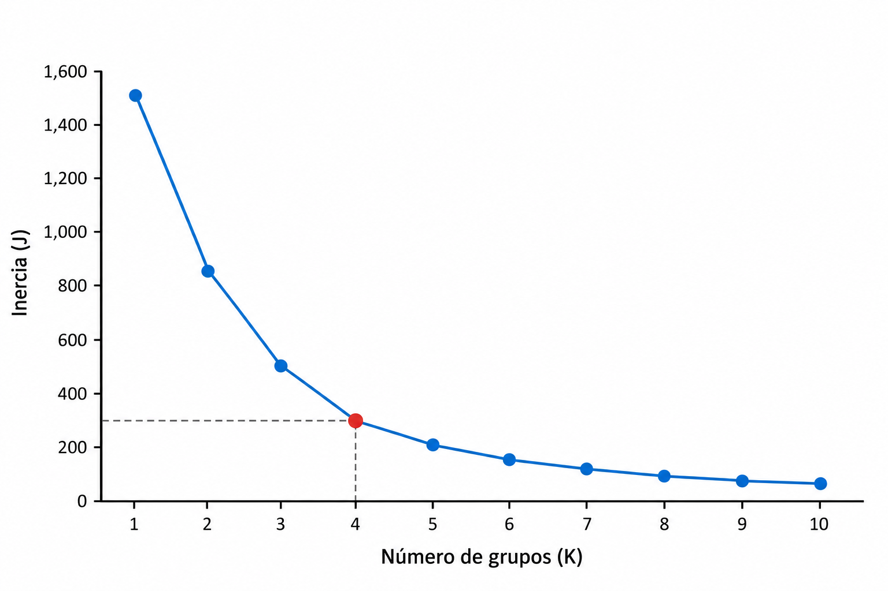
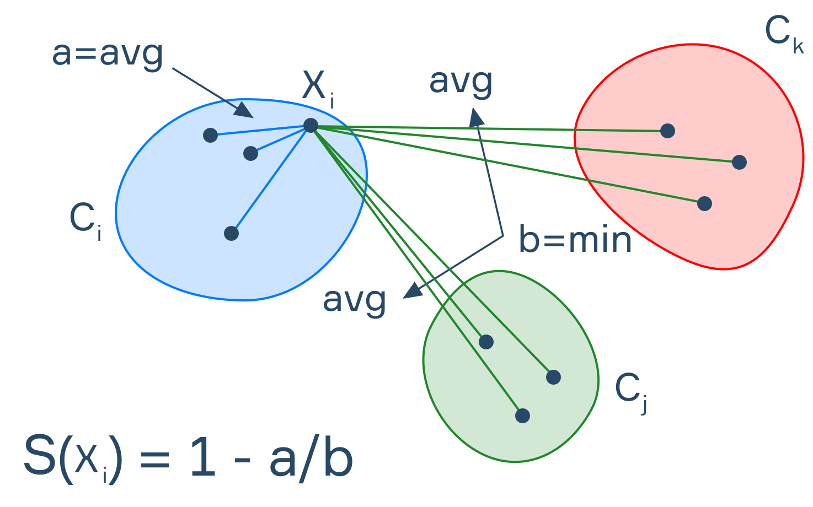

## Introducción

En el **aprendizaje no supervisado**, los algoritmos buscan identificar patrones y estructuras en conjuntos de datos que no contienen etiquetas.

Una de las técnicas más utilizadas es el **agrupamiento (clustering)**, cuyo objetivo es identificar observaciones con características similares.

## ¿Qué es el clustering?

El clustering consiste en dividir un conjunto de observaciones en grupos, llamados *clusters*, de acuerdo con sus características.

Se busca que:

- Las observaciones dentro de un mismo grupo sean similares.
- Las observaciones de grupos diferentes presenten mayores diferencias.

:::{.example}
- Agrupamiento de clientes según hábitos de consumo.
- Identificación de patrones de consumo energético.
- Agrupamiento de regiones según características climáticas.
:::

## ¿Qué es K-means?

:::: {.columns}

::: {.column width="50%"}

**K-means** es un algoritmo de aprendizaje no supervisado que divide un conjunto de datos en $K$ grupos.

Cada grupo está representado por un punto llamado **centroide**, que corresponde al promedio de las observaciones asignadas a ese grupo.

:::

::: {.column width="50%"}

{width=100%}

:::

::::

El algoritmo busca encontrar grupos cuyas observaciones estén lo más cerca posible de sus respectivos centroides usando usualmente la **distancia euclidiana** como medida de cercania.

## ¿Cómo funciona K-means?

El algoritmo sigue un procedimiento iterativo:

1. Seleccionar el número de grupos $K$.
2. Inicializar $K$ centroides.
3. Asignar cada observación al centroide más cercano.
4. Actualizar los centroides utilizando el promedio de las observaciones asignadas.
5. Repetir los pasos 3 y 4 hasta alcanzar un criterio de convergencia.

## Ejemplo

Aplica el algoritmo K-means para agrupar en dos clusters las siguientes observaciones utilizando la distancia euclidiana. Utiliza 
$$
\mu_1=(1,1),\qquad \mu_2=(6,6)
$$
como centroides iniciales.

| Observación | $x_1$ | $x_2$ |
|:---|---:|---:|
| A | 1 | 1 |
| B | 1 | 2 |
| C | 2 | 1 |
| D | 6 | 6 |
| E | 6 | 7 |
| F | 7 | 6 |

## Función objetivo

$K$-means busca minimizar la suma de las distancias cuadráticas entre las observaciones y sus centroides.

$$
J=\sum_{j=1}^{K}\sum_{x_i\in C_j}
\|x_i-\mu_j\|^2,
$$

:::{.formula}
$J$ se conoce como **inercia** o suma de cuadrados dentro de los grupos (WCSS, *Within-Cluster Sum of Squares*).

Se utiliza para medir qué tan compactos son los grupos: cuanto menor sea $J$, más cerca estarán las observaciones de sus respectivos centroides.

:::

## Hiperparámetros de K-means

| Hiperparámetro | Descripción |
|:---|:---|
| `n_clusters` | Número de grupos ($K$) que se desea formar. |
| `init` | Método utilizado para inicializar los centroides |
| `max_iter` | Número máximo de iteraciones por ejecución. |
| `tol` | Tolerancia utilizada para determinar la convergencia. |
| `random_state` | Semilla para controlar la aleatoriedad y reproducir resultados. |

## ¿Cómo seleccionar K?

:::: {.columns}

::: {.column width="50%"}

El número de grupos $K$ debe establecerse antes de ejecutar el algoritmo.

Una elección inadecuada puede producir:

- Pocos grupos que mezclan observaciones diferentes.
- Demasiados grupos que fragmentan estructuras similares.

:::

::: {.column width="50%"}

{width=100%}

:::

::::

## Método del codo (Elbow Method)

:::: {.columns}

::: {.column width="50%"}

El método del codo consiste en ejecutar $K$-means utilizando diferentes valores de $K$ y calcular la inercia correspondiente.

A medida que aumenta $K$, la inercia disminuye o permanece igual.

Se busca un punto donde la reducción comienza a ser menos pronunciada.
:::

::: {.column width="50%"}

:::

::::

:::{.formula}
**Limitación:** No todos los conjuntos de datos presentan un codo claramente identificable.
:::

## Coeficiente de silueta

:::: {.columns}

::: {.column width="50%"}

El coeficiente de silueta evalúa qué tan similar es una observación a las de su propio grupo en comparación con las de otros grupos.

$$
s(i)=\frac{b(i)-a(i)}{\max(a(i),b(i))}
$$

:::

::: {.column width="50%"}

{width=100%}

:::

::::

- $a(i)$: distancia promedio de la observación $i$ a las demás observaciones de su grupo.
- $b(i)$: menor distancia promedio de la observación $i$ a las observaciones de otro grupo.

## Coeficiente de silueta {.unlisted}

**Distancia promedio dentro del grupo:**

$$
a(i)=\frac{1}{|C_i|-1}
\sum_{\substack{j\in C_i\\j\neq i}}d(x_i,x_j)
$$

**Distancia promedio mínima a otro grupo:**

$$
b(i)=\min_{C_k\neq C_i}
\left\{
\frac{1}{|C_k|}
\sum_{j\in C_k}d(x_i,x_j)
\right\}
$$

**Nota:** Para grupos con una sola observación, el coeficiente de silueta se define convencionalmente como $0$.

## Interpretación del coeficiente de silueta

| Valor | Interpretación |
|:---|:---|
| Cercano a 1 | Observación bien agrupada. |
| Cercano a 0 | Observación próxima a la frontera entre grupos. |
| Negativo | Observación posiblemente asignada a un grupo inadecuado. |

El promedio de los coeficientes de silueta puede utilizarse para comparar diferentes valores de $K$.

## Consideraciones importantes

- **Escalamiento:** Las variables con valores de mayor magnitud pueden dominar el cálculo de distancias.
- **Inicialización:** Diferentes centroides iniciales pueden producir resultados distintos.
- **Valores atípicos:** Los centroides pueden verse afectados por observaciones extremas.
- **Forma de los grupos:** K-means funciona mejor con grupos relativamente compactos y aproximadamente esféricos.
- **Interpretación:** Los grupos encontrados no necesariamente corresponden a categorías reales o conocidas.

## Preguntas

:::: {.columns}

::: {.column width="45%"}
{width=95%}
:::

::: {.column width="55%"}

::: {.vcenter}

¿Seguro? 🤨

Bueno...

Pregúntale a [ChatGPT](https://chatgpt.com) pues.

:::
:::

::::

## ¿Qué sigue?

En el siguiente notebook implementaremos $K$-means sobre un conjunto de datos, analizaremos los grupos obtenidos y evaluaremos diferentes valores de $K$.
