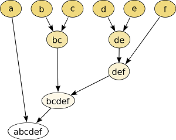
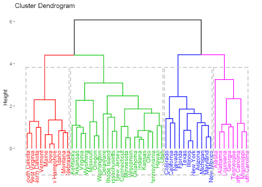
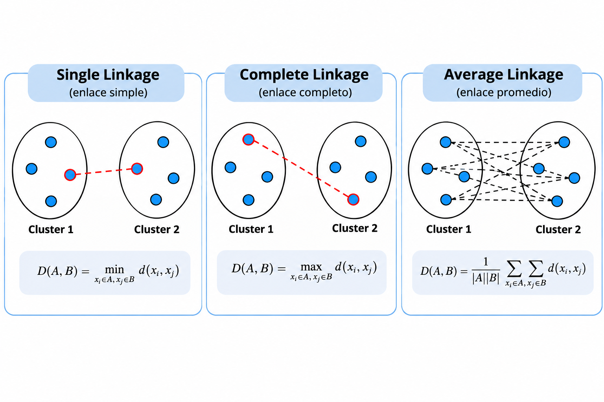
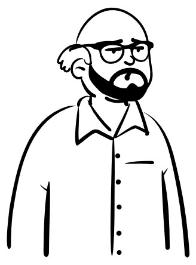

---
title: "Aprendizaje no supervisado"
subtitle: "Clustering jerárquico"
author: "Dra. Denisse Urenda Castañeda"

lang: es

bibliography: ../../recursos/referencias.bib
csl: ../../recursos/ieee.csl

format:
  revealjs:
    css: ../../recursos/slides.css
    include-after-body:
      text: |
        <a href="../index.html" class="home-button">
        📖 Lecciones
        </a>
    theme: simple
    slide-number: c/t
    transition: fade
    toc: true
    toc-depth: 2
    incremental: false
    center: false
    footer: "Modelado de Datos · UACJ"
---

## ¿Qué es el clustering jerárquico?

El **clustering jerárquico** es una técnica de aprendizaje no supervisado que organiza las observaciones en una estructura de grupos anidados, de acuerdo con su similitud.

A diferencia de K-means, no requiere establecer inicialmente el número de clusters.

Existen dos enfoques:

- **Aglomerativo:** comienza con cada observación en un grupo y los combina progresivamente.
- **Divisivo:** comienza con todas las observaciones en un grupo y lo divide progresivamente.

## ¿Cómo funciona?

:::: {.columns}

::: {.column width="55%"}

El clustering jerárquico aglomerativo sigue los siguientes pasos:

1. Considerar cada observación como un cluster independiente.
2. Calcular las distancias entre los clusters.
3. Identificar los dos clusters más cercanos.
4. Unirlos en un nuevo cluster.
5. Repetir hasta obtener un único cluster.

:::

::: {.column width="45%"}

{width=100%}

:::

::::

:::{.formula}
El resultado puede representarse mediante un **dendrograma**.
:::

## ¿Qué es un dendrograma?

:::: {.columns}

::: {.column width="55%"}

Un **dendrograma** es una representación gráfica que muestra cómo se agrupan progresivamente las observaciones.

- Las hojas representan las observaciones.
- Las ramas representan las uniones entre clusters.
- La altura de cada unión indica la distancia o disimilitud a la que se realizó.

:::

::: {.column width="45%"}

{width=100%}

:::

::::

:::{.formula}
El dendrograma permite seleccionar diferentes números de grupos mediante un corte horizontal.
:::

## Criterios de enlace (linkage)

Para decidir qué clusters unir, es necesario definir cómo calcular la distancia entre dos grupos.

| Criterio | Descripción |
|:---|:---|
| Single | Distancia mínima entre observaciones de ambos grupos. |
| Complete | Distancia máxima entre observaciones de ambos grupos. |
| Average | Promedio de las distancias entre observaciones de ambos grupos. |

La elección del criterio puede modificar los agrupamientos obtenidos.

## Criterios de enlace (linkage) {.unlisted}

## Ejemplo

Utiliza las siguientes observaciones para construir un **dendrograma**, aplicando clustering jerárquico aglomerativo con distancia euclidiana y el criterio **single linkage**.

$$
X=\{1,2,4,7,8,12\}
$$

## Consideraciones importantes

- No es necesario establecer inicialmente el número de clusters.
- El dendrograma permite explorar diferentes agrupamientos.
- Los resultados dependen de la métrica de distancia y del criterio de enlace.
- Puede ser computacionalmente costoso para conjuntos de datos grandes.
- Es sensible a valores atípicos y a la escala de las variables.

## Preguntas

:::: {.columns}

::: {.column width="45%"}
{width=95%}
:::

::: {.column width="55%"}

::: {.vcenter}

¿Seguro? 🤨

Bueno...

Pregúntale a [ChatGPT](https://chatgpt.com) pues.

:::
:::

::::

## ¿Qué sigue?

En el siguiente notebook implementaremos clustering jerárquico y utilizaremos un dendrograma para explorar diferentes agrupamientos.
