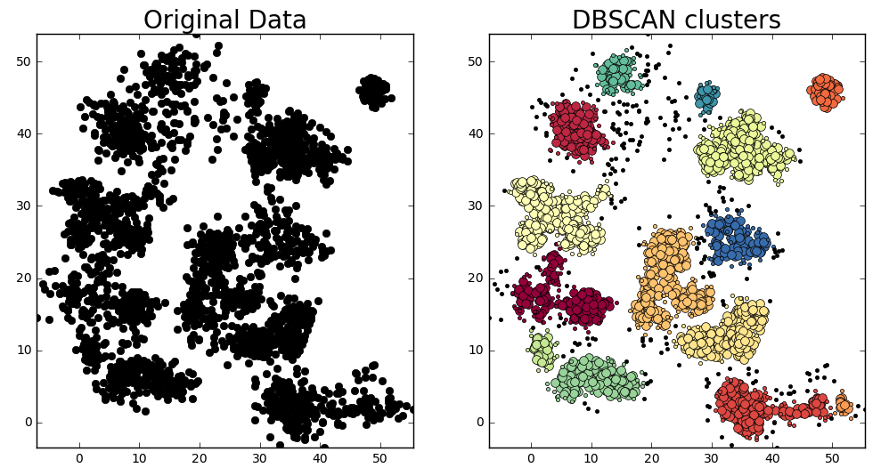
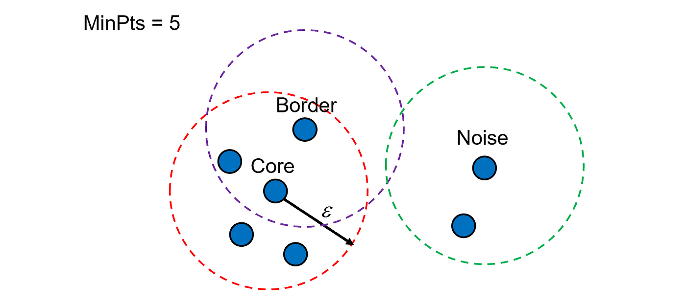
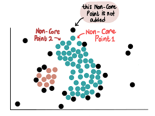

---
title: "Aprendizaje no supervisado"
subtitle: "Algoritmo DBSCAN"
author: "Dra. Denisse Urenda Castañeda"

lang: es

bibliography: ../../recursos/referencias.bib
csl: ../../recursos/ieee.csl

format:
  revealjs:
    css: ../../recursos/slides.css
    include-after-body:
      text: |
        <a href="../index.html" class="home-button">
        📖 Lecciones
        </a>
    theme: simple
    slide-number: c/t
    transition: fade
    toc: true
    toc-depth: 2
    incremental: false
    center: false
    footer: "Modelado de Datos · UACJ"
---

## ¿Qué es DBSCAN?

**DBSCAN** (*Density-Based Spatial Clustering of Applications with Noise*) es un algoritmo de aprendizaje no supervisado que identifica clusters a partir de regiones con alta densidad de observaciones.

A diferencia de K-means:

- No requiere establecer el número de clusters.
- Puede identificar grupos con formas irregulares.
- Permite identificar observaciones que no pertenecen a ningún cluster, consideradas ruido.

:::{.example}
DBSCAN puede utilizarse para identificar zonas de alta concentración de eventos geográficos y detectar ubicaciones aisladas.
:::

## ¿Qué es DBSCAN? {.unlisted}

## Concepto de densidad

DBSCAN considera que una observación pertenece a una región densa cuando tiene suficientes observaciones cercanas.

Para ello utiliza dos parámetros:

:::{.columns}

::: {.column width="60%"}

- **$\varepsilon$ (eps):** radio de la vecindad alrededor de una observación.
- **MinPts:** número mínimo de observaciones necesarias para considerar una región suficientemente densa, incluyendo la propia observación.
:::

::: {.column width="40%"}
:::{style="width: 500px; margin: auto;"}
{width="90%"}
:::
:::

:::

La vecindad de una observación $x_i$ se define como:
$$
N_\varepsilon(x_i)=
\{x_j:d(x_i,x_j)\leq\varepsilon\}
$$

## Tipos de observaciones

DBSCAN clasifica las observaciones en tres categorías:

:::{.columns}
:::{.column width="60%"}

- **Núcleo** (core): Tiene al menos MinPts observaciones en su vecindad, incluyéndose a sí misma.
- **Borde** (border): No es núcleo, pero está dentro de la vecindad de un punto núcleo.
- **Ruido** (noise): No es núcleo ni pertenece a la vecindad de ningún punto núcleo.
:::

:::{.column width="40%"}
:::{style="width: 500px; margin: auto;"}
{width="90%"}
:::
:::
:::

:::{.formula}
Una observación es un punto núcleo cuando:
$$
|N_\varepsilon(x_i)|\geq MinPts
$$
:::

## ¿Cómo funciona DBSCAN?

El algoritmo sigue los siguientes pasos:

1. Seleccionar una observación no visitada.
2. Identificar sus vecinos dentro del radio $\varepsilon$.
3. Si es un punto núcleo, iniciar un nuevo cluster.
4. Expandir el cluster incorporando observaciones conectadas a través de puntos núcleo.
5. Repetir hasta procesar todas las observaciones.

Las observaciones que no pertenecen a ningún cluster se clasifican como ruido.

## Ejemplo

Aplica el algoritmo **DBSCAN** a las siguientes observaciones:

$$
X=\{1.0,\ 1.2,\ 1.4,\ 5.0,\ 5.2,\ 5.4,\ 9.0\}
$$

Utiliza los parámetros:

$$
\varepsilon=0.3,\qquad MinPts=3
$$

Identifica los **puntos núcleo, puntos de borde y puntos de ruido**, y determina los clusters resultantes.

**Nota:** MinPts incluye la propia observación.

## Hiperparámetros de DBSCAN

| Hiperparámetro | Descripción |
|:---|:---|
| `eps` | Radio máximo para considerar dos observaciones vecinas. |
| `min_samples` | Número mínimo de observaciones en una vecindad, incluyendo la propia observación. |
| `metric` | Métrica utilizada para calcular distancias. |

La elección de estos parámetros afecta directamente los clusters identificados.

## Consideraciones importantes

- No requiere definir previamente el número de clusters.
- Puede identificar grupos de formas irregulares.
- Permite detectar observaciones aisladas.
- Es sensible a la elección de $\varepsilon$ y MinPts.
- Puede presentar dificultades cuando los clusters tienen densidades muy diferentes.
- El escalamiento de las variables puede afectar los resultados.

## Preguntas

:::: {.columns}

::: {.column width="45%"}
{width=95%}
:::

::: {.column width="55%"}

::: {.vcenter}

¿Seguro? 🤨

Bueno...

Pregúntale a [ChatGPT](https://chatgpt.com) pues.

:::
:::

::::

## ¿Qué sigue?

En el siguiente notebook implementaremos DBSCAN, analizaremos los grupos identificados y exploraremos cómo cambian los resultados al modificar sus hiperparámetros.
