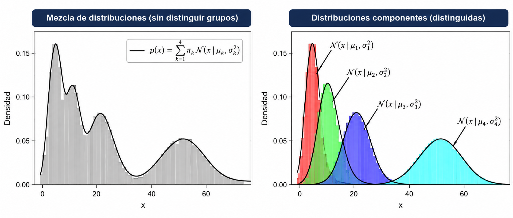
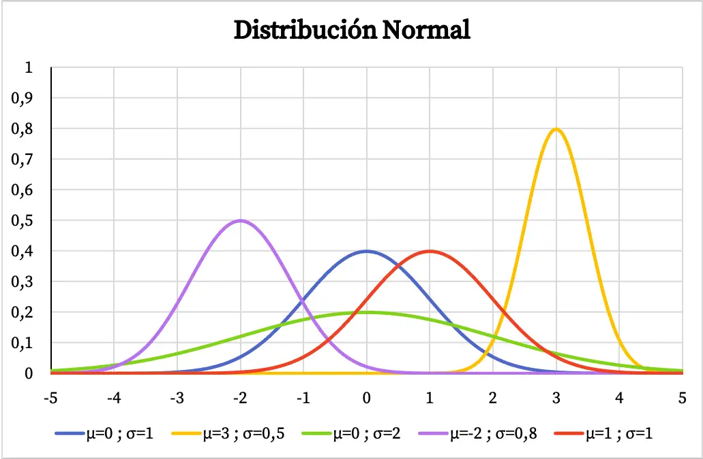
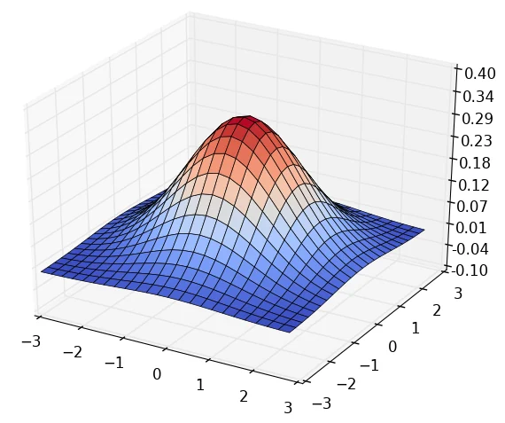
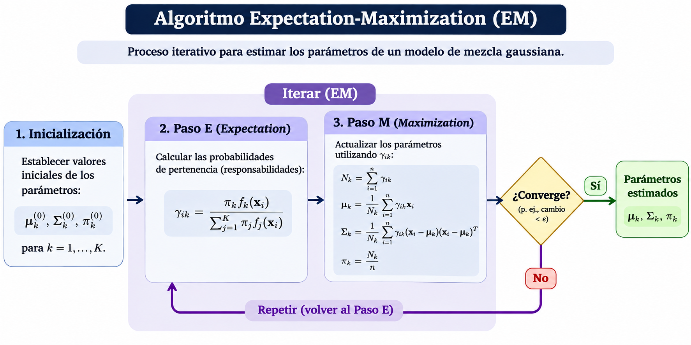

---
title: "Aprendizaje no supervisado"
subtitle: "Modelos de mezclas gaussianas (GMM)"
author: "Dra. Denisse Urenda Castañeda"

lang: es

bibliography: ../../recursos/referencias.bib
csl: ../../recursos/ieee.csl

format:
  revealjs:
    css: ../../recursos/slides.css
    include-after-body:
      text: |
        <a href="../index.html" class="home-button">
        📖 Lecciones
        </a>
    theme: simple
    slide-number: c/t
    transition: fade
    toc: true
    toc-depth: 2
    incremental: false
    center: false
    footer: "Modelado de Datos · UACJ"
---

## Introducción

Los **modelos de mezclas gaussianas** (*Gaussian Mixture Models*, GMM) son modelos probabilísticos que representan los datos mediante una combinación de distribuciones normales.

Cada distribución gaussiana representa un componente de la mezcla que puede asociarse con un cluster.

:::{.formula}
A diferencia de K-means:

- Permiten representar clusters con diferentes formas, tamaños y orientaciones.
- Asignan probabilidades de pertenencia a cada cluster.
- Permiten que las distribuciones de los clusters se superpongan.
:::

## Introducción {.unlisted}

## Distribución gaussiana

Una **distribución gaussiana** describe cómo se distribuyen las observaciones alrededor de una media.

:::: {.columns}

::: {.column width="50%"}

En una dimensión, su función de densidad es:

$$
f(x)=\frac{1}{\sqrt{2\pi\sigma^2}}
\exp\left(-\frac{(x-\mu)^2}{2\sigma^2}\right)
$$

donde:

- $\mu$: media de la distribución.
- $\sigma^2$: varianza de la distribución.
- $x$: valor de una observación.

:::

::: {.column width="50%"}

{width=100%}

:::

::::

## Distribución gaussiana {.unlisted}

Cuando las observaciones tienen varias variables, se utiliza una **distribución gaussiana multivariada**. Su función de densidad es:

$$
f(\mathbf{x})=
\frac{1}{(2\pi)^{d/2}|\Sigma|^{1/2}}
\exp\left(
-\frac{1}{2}
(\mathbf{x}-\boldsymbol{\mu})^T
\Sigma^{-1}
(\mathbf{x}-\boldsymbol{\mu})
\right)
$$

:::: {.columns}

::: {.column width="55%"}

donde:

- $\mathbf{x}$: vector de características de una observación.
- $\boldsymbol{\mu}$: vector de medias de las variables.
- $\Sigma$: matriz de covarianzas que describe la dispersión y relación entre las variables.

:::

::: {.column width="45%"}

{width=100%}

:::

::::

## Modelo de mezclas gaussianas

Un GMM supone que las observaciones provienen de una combinación de $K$ distribuciones gaussianas. Su función de densidad se expresa como:

:::{.formula}
$$
p(x)=\sum_{k=1}^{K}\pi_k
\mathcal{N}(x\mid\boldsymbol{\mu}_k,\Sigma_k),
\quad \sum_{k=1}^{K}\pi_k=1
$$
:::

donde:

- $\pi_k$: peso del componente $k$.
- $\boldsymbol{\mu}_k, \Sigma_k$: vector de medias y matriz de covarianzas.
- $\mathcal{N}$: densidad de la distribución normal.

## Asignación probabilística

A diferencia de K-means, GMM utiliza una **asignación suave** (*soft clustering*).

Cada observación tiene una probabilidad de pertenecer a cada componente.

Por ejemplo:

| Observación | Cluster 1 | Cluster 2 |
|:---|---:|---:|
| A | 0.95 | 0.05 |
| B | 0.60 | 0.40 |
| C | 0.10 | 0.90 |

Si se requiere una asignación única, la observación se asigna al componente con mayor probabilidad.

## Ejemplo: probabilidades de pertenencia

Considera las observaciones:

$$
X=\{1,2,3,5,6,7\}
$$

Supongamos que inicialmente tenemos dos componentes gaussianos:

| Parámetro | Gaussiana 1 | Gaussiana 2 |
|:---|---:|---:|
| Media $\mu$ | 2 | 6 |
| Varianza $\sigma^2$ | 4 | 4 |
| Peso $\pi$ | 0.5 | 0.5 |

Queremos calcular la **probabilidad de pertenencia** de la observación $x=3$ a cada componente.

## Ejemplo: probabilidades de pertenencia {.unlisted}

Primero, evaluamos las funciones de densidad:

$$
f_k(x)=\frac{1}{\sqrt{2\pi\sigma_k^2}}
\exp\left(-\frac{(x-\mu_k)^2}{2\sigma_k^2}\right)
$$

Obtenemos:

$$
f_1(3)\approx 0.1760,\qquad
f_2(3)\approx 0.0648
$$

Para obtener las probabilidades de pertenencia, utilizamos el **teorema de Bayes**:

$$
P(z=k\mid x)=
\frac{\pi_k f_k(x)}
{\sum_{j=1}^{K}\pi_j f_j(x)}
$$

## Ejemplo: probabilidades de pertenencia {.unlisted}

Para la primera gaussiana:

$$
P(z=1\mid x=3)=
\frac{0.5(0.1760)}
{0.5(0.1760)+0.5(0.0648)}
\approx 0.731
$$

Para la segunda gaussiana:

$$
P(z=2\mid x=3)=
\frac{0.5(0.0648)}
{0.5(0.1760)+0.5(0.0648)}
\approx 0.269
$$

Por lo tanto, la observación $x=3$ tiene mayor probabilidad de pertenecer al primer componente, pero ambos componentes contribuyen a explicar su origen.

## Algoritmo EM
Los parámetros se estiman mediante el algoritmo **Expectation-Maximization (EM)**.

1. **Inicialización:** establecer medias $\boldsymbol{\mu}_k^{0}$, covarianzas $\Sigma_k^{0}$ y pesos iniciales $\pi_k^{0}$.

2. **Paso E (Expectation):** calcular las probabilidades de pertenencia $\gamma_{ik}$.

3. **Paso M (Maximization):** actualizar los parámetros $\boldsymbol{\mu}_k, \Sigma_k, \pi_k$.

4. **Repetición:** alternar los pasos E y M hasta alcanzar la convergencia.

## Algoritmo EM {.unlisted}

## Hiperparámetros de GMM

| Hiperparámetro | Descripción |
|:---|:---|
| `n_components` | Número de componentes gaussianos. |
| `max_iter` | Número máximo de iteraciones del algoritmo EM. |
| `tol` | Tolerancia utilizada para determinar la convergencia. |
| `random_state` | Semilla para controlar la aleatoriedad. |

:::{.formula}
El número de componentes puede seleccionarse utilizando criterios como **AIC** o **BIC**.

Se ajustan modelos con distintos valores de $K$ y se selecciona aquel que **minimiza AIC o BIC**, según el criterio elegido.
:::

## Consideraciones importantes

- Requiere establecer el número de componentes gaussianos.
- Permite asignaciones probabilísticas.
- Puede representar clusters elípticos.
- Es sensible a la inicialización y puede converger a óptimos locales.
- Puede presentar problemas cuando las matrices de covarianza son singulares o casi singulares.

## Preguntas

:::: {.columns}

::: {.column width="45%"}
{width=95%}
:::

::: {.column width="55%"}

::: {.vcenter}

¿Seguro? 🤨

Bueno...

Pregúntale a [ChatGPT](https://chatgpt.com) pues.

:::
:::

::::

## ¿Qué sigue?

En el siguiente notebook implementaremos un modelo de mezclas gaussianas, visualizaremos las distribuciones estimadas y analizaremos cómo cambian los resultados al modificar el número de componentes y las matrices de covarianza.
