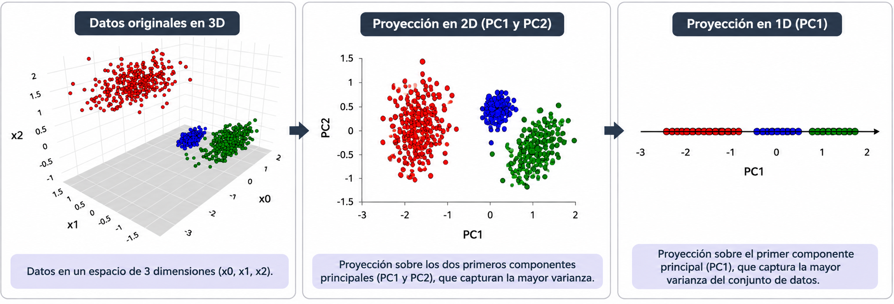
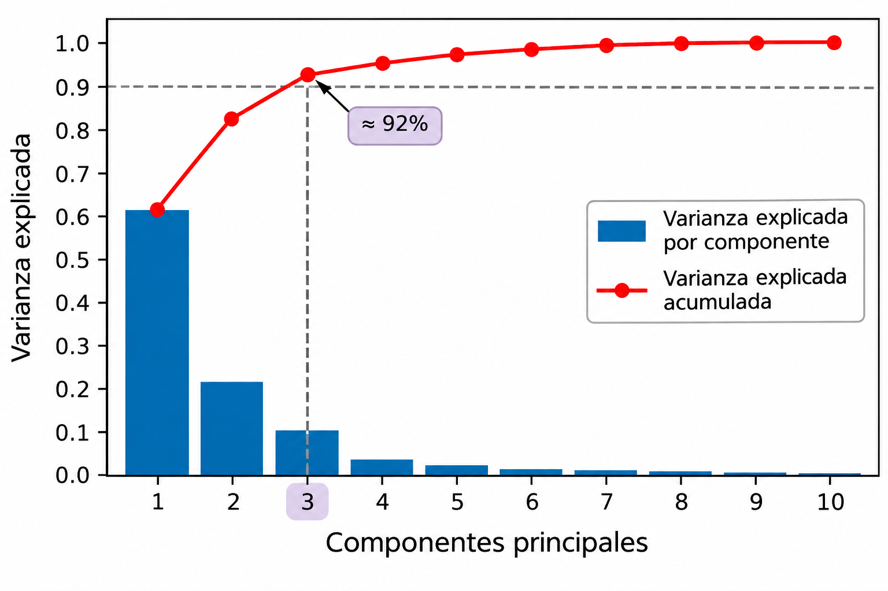

---
title: "Aprendizaje no supervisado"
subtitle: "Análisis de Componentes Principales (PCA)"
author: "Dra. Denisse Urenda Castañeda"

lang: es

bibliography: ../../recursos/referencias.bib
csl: ../../recursos/ieee.csl

format:
  revealjs:
    css: ../../recursos/slides.css
    include-after-body:
      text: |
        <a href="../index.html" class="home-button">
        📖 Lecciones
        </a>
    theme: simple
    slide-number: c/t
    transition: fade
    toc: true
    toc-depth: 2
    incremental: false
    center: false
    footer: "Modelado de Datos · UACJ"
---

## Introducción

El **Análisis de Componentes Principales** (*Principal Component Analysis*, PCA) es una técnica de aprendizaje no supervisado utilizada para reducir la dimensionalidad de los datos.

Su objetivo es construir nuevas variables, llamadas **componentes principales**, que conserven la mayor cantidad posible de variabilidad de los datos originales.

- Reduce el número de variables.
- Facilita la visualización de datos de alta dimensionalidad.
- Puede eliminar redundancia entre variables correlacionadas.

## Introducción {.unlisted}

## Componentes principales

Los componentes principales son **nuevas variables** obtenidas mediante combinaciones lineales de las variables originales.

$$
PC_k = w_{k1}(x_1-\mu_1)+w_{k2}(x_2-\mu_2)+\cdots+w_{kp}(x_p-\mu_p)
$$

Cada componente tiene una dirección que describe parte de la variabilidad de los datos.

- **PC1:** dirección que captura la mayor varianza posible.
- **PC2:** dirección ortogonal a PC1 que captura la mayor varianza restante.
- **PC3:** dirección ortogonal a las anteriores que captura la mayor varianza restante.

Los componentes son ortogonales entre sí y están ordenados según la varianza que explican.

## Formulación matemática

PCA busca las direcciones sobre las cuales proyectar los datos para conservar la mayor varianza posible.

El primer componente principal se obtiene resolviendo:

$$
\boxed{
\mathbf{w}_1 =
\underset{\mathbf{w}}{\operatorname{arg\,max}}
\left\{\mathbf{w}^T\Sigma\mathbf{w}\right\}, 
\quad \text{s.t.}
\quad \mathbf{w}^T\mathbf{w}=1
}
$$

donde:

- $\Sigma$: matriz de covarianzas de los datos.
- $\mathbf{w}$: dirección de proyección candidata.
- $\mathbf{w}_1$: dirección óptima del primer componente principal.

## Formulación matemática

Una vez obtenida esta dirección, el primer componente principal se calcula como:

$$
PC_1=\mathbf{w}_1^T(\mathbf{x}-\boldsymbol{\mu})
$$

Los siguientes componentes se obtienen mediante el mismo problema de optimización, agregando restricciones de **ortogonalidad respecto a los componentes anteriores**, es decir

$$
\boxed{
\begin{aligned}
\mathbf{w}_i
&=
\underset{\mathbf{w}}{\operatorname{arg\,max}}
\left\{\mathbf{w}^T\Sigma\mathbf{w}\right\}\\[6pt]
\text{s.a.}\quad
&\mathbf{w}^T\mathbf{w}=1\\
&\mathbf{w}^T\mathbf{w}_j=0,
\quad j=1,\ldots,i-1
\end{aligned}
}
$$

## Relación con los eigenvectores y eigenvalores

El problema de optimización de PCA se resuelve encontrando los **eigenvectores y eigenvalores** de la matriz de covarianzas:

$$
\Sigma\mathbf{w}_k=\lambda_k\mathbf{w}_k
$$

donde:

- $\mathbf{w}_k$: eigenvector que define la dirección del componente principal $k$.
- $\lambda_k$: eigenvalor que representa la varianza explicada por ese componente.

Los eigenvectores se ordenan de acuerdo con sus eigenvalores: 
$$
\lambda_1\geq\lambda_2\geq\cdots\geq\lambda_p.
$$

## Relación con los eigenvectores y eigenvalores {.unlisted}

Recordemos que PCA busca la dirección que **maximiza la varianza de los datos proyectados**:

$$
\max_{\mathbf{w}}\quad \mathbf{w}^T\Sigma\mathbf{w},
\qquad \text{s.a.}\quad \mathbf{w}^T\mathbf{w}=1
$$

Para resolver este problema utilizamos **multiplicadores de Lagrange**:

$$
\mathcal{L}(\mathbf{w},\lambda)
=
\mathbf{w}^T\Sigma\mathbf{w}
-
\lambda(\mathbf{w}^T\mathbf{w}-1)
$$

Derivamos respecto a $\mathbf{w}$ e igualamos a cero:

$$
\nabla_{\mathbf{w}}\mathcal{L}
=
2\Sigma\mathbf{w}-2\lambda\mathbf{w}=0
$$

Por lo tanto:
$$
\boxed{\Sigma\mathbf{w}=\lambda\mathbf{w}}
$$

## Relación con los eigenvectores y eigenvalores {.unlisted}

La varianza de los datos proyectados sobre una dirección $\mathbf{w}$ es:

$$
\operatorname{Var}(PC)=\mathbf{w}^T\Sigma\mathbf{w}
$$

Sabemos que, para un eigenvector $\mathbf{w}$ de la matriz $\Sigma$
$$
\Sigma\mathbf{w}=\lambda\mathbf{w}
$$

Sustituyendo

$$
\begin{aligned}
\operatorname{Var}(PC)
&=\mathbf{w}^T(\lambda\mathbf{w})\\
&=\lambda\mathbf{w}^T\mathbf{w}\\
&=\lambda
\end{aligned}
$$

Por lo tanto, **cada eigenvalor representa la varianza capturada por su componente principal**.

## Varianza explicada

Cada componente principal conserva una proporción de la varianza total de los datos. La **proporción de varianza explicada** por el componente $k$ es:

$$
VE_k=\frac{\lambda_k}{\sum_{j=1}^{p}\lambda_j}
$$

La varianza explicada acumulada por los primeros $m$ componentes es:

$$
VE_{acum}(m)=\sum_{k=1}^{m}VE_k
$$

Esto permite evaluar cuánta variabilidad se conserva al reducir la dimensionalidad.

## Selección del número de componentes

El número de componentes principales puede seleccionarse analizando la **varianza explicada acumulada**.

Dos criterios habituales son:

:::: {.columns}

::: {.column width="50%"}

- **Umbral de varianza:** seleccionar el menor número de componentes que permita conservar una proporción determinada de la varianza total, por ejemplo, 90% o 95%.

- **Método del codo:** identificar el punto a partir del cual agregar más componentes produce incrementos cada vez menores en la varianza explicada acumulada.

:::

::: {.column width="50%"}

{width=100%}

:::

::::

## Consideraciones importantes

- PCA es una técnica de reducción de dimensionalidad, no un algoritmo de clustering.
- Los componentes son combinaciones lineales de las variables originales.
- Maximiza la varianza conservada, no necesariamente la información relevante para una tarea predictiva.
- Es sensible a la escala de las variables.
- Generalmente se recomienda estandarizar cuando las variables tienen diferentes unidades o magnitudes.
- Los componentes pueden ser difíciles de interpretar.
- La reducción de dimensionalidad puede ocasionar pérdida de información.

## Preguntas

:::: {.columns}

::: {.column width="45%"}
{width=95%}
:::

::: {.column width="55%"}

::: {.vcenter}

¿Seguro? 🤨

Bueno...

Pregúntale a [ChatGPT](https://chatgpt.com) pues.

:::
:::

::::

## ¿Qué sigue?

En el siguiente notebook implementaremos PCA, analizaremos la varianza explicada y visualizaremos cómo cambia la representación de los datos al reducir su dimensionalidad.
