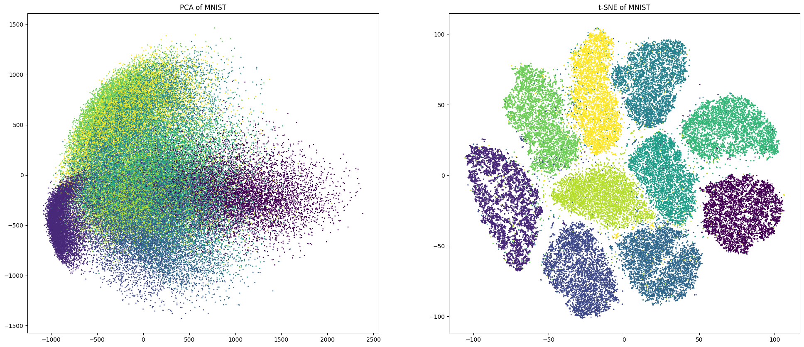

---
title: "Aprendizaje no supervisado"
subtitle: "t-SNE"
author: "Dra. Denisse Urenda Castañeda"

lang: es

bibliography: ../../recursos/referencias.bib
csl: ../../recursos/ieee.csl

format:
  revealjs:
    css: ../../recursos/slides.css
    include-after-body:
      text: |
        <a href="../index.html" class="home-button">
        📖 Lecciones
        </a>
    theme: simple
    slide-number: c/t
    transition: fade
    toc: true
    toc-depth: 2
    incremental: false
    center: false
    footer: "Modelado de Datos · UACJ"
---

## Introducción

**t-SNE** (*t-distributed Stochastic Neighbor Embedding*) es una técnica no lineal de reducción de dimensionalidad utilizada principalmente para visualizar datos de alta dimensionalidad.

Su objetivo es construir una representación de menor dimensión que preserve las **relaciones de proximidad entre observaciones**.

- Permite representar datos en dos o tres dimensiones.
- Busca conservar principalmente las relaciones locales.
- Facilita la exploración visual de posibles agrupamientos.

## Introducción {.unlisted}

## ¿Cómo funciona?

Consideremos un conjunto de observaciones:

$$
X=\{\mathbf{x}_1,\mathbf{x}_2,\ldots,\mathbf{x}_n\},
\qquad \mathbf{x}_i\in\mathbb{R}^p
$$

Queremos obtener una representación:

$$
Y=\{\mathbf{y}_1,\mathbf{y}_2,\ldots,\mathbf{y}_n\},
\qquad \mathbf{y}_i\in\mathbb{R}^2
$$

De manera general, t-SNE:

1. Calcula similitudes entre observaciones en el espacio original.
2. Calcula similitudes en el espacio reducido.
3. Ajusta las posiciones de las observaciones para que ambas distribuciones de similitud sean parecidas.

## Similitudes en el espacio original

En lugar de trabajar directamente con las distancias, t-SNE las transforma en **probabilidades de similitud**.

Primero calcula probabilidad de similitud de $\mathbf{x}_j$ respecto a $\mathbf{x}_i$.

$$
p_{j|i}=
\frac{
\exp\left(-\frac{\|\mathbf{x}_i-\mathbf{x}_j\|^2}{2\sigma_i^2}\right)
}{
\sum_{k\neq i}
\exp\left(-\frac{\|\mathbf{x}_i-\mathbf{x}_k\|^2}{2\sigma_i^2}\right)
}
$$

donde:

- $\mathbf{x}_i,\mathbf{x}_j$: observaciones originales.
- $\sigma_i$: controla la escala de vecindad alrededor de $\mathbf{x}_i$.

## Similitudes en el espacio original {.unlisted}

Como las probabilidades condicionales pueden ser diferentes en ambas direcciones, t-SNE construye probabilidades simétricas:

$$
\boxed{
p_{ij}=\frac{p_{j|i}+p_{i|j}}{2}
}
$$

Estas probabilidades describen las relaciones de similitud en el espacio original.

- Valores grandes de $p_{ij}$ indican observaciones cercanas.
- Valores pequeños indican observaciones poco similares.

El objetivo será conservar estas relaciones en una representación de menor dimensión.

## Similitudes en el espacio reducido

Ahora buscamos representar cada observación mediante un punto $\mathbf{y}_i$ en dos dimensiones.

En este espacio, t-SNE utiliza una **distribución t de Student con un grado de libertad** para calcular las similitudes:

$$
\boxed{
q_{ij}=
\frac{
(1+\|\mathbf{y}_i-\mathbf{y}_j\|^2)^{-1}
}{
\sum_{k\neq l}
(1+\|\mathbf{y}_k-\mathbf{y}_l\|^2)^{-1}
}
}
$$

donde:

- $\mathbf{y}_i,\mathbf{y}_j$: posiciones en el espacio reducido.
- $q_{ij}$: similitud entre ambas observaciones en la nueva representación.

La distribución t tiene **colas más pesadas** que una distribución normal, lo que ayuda a representar puntos poco similares suficientemente separados.

## Función objetivo

Tenemos dos distribuciones de similitud:

- $P$: similitudes en el espacio original.
- $Q$: similitudes en el espacio reducido.

Queremos que ambas sean lo más parecidas posible.

Para medir su diferencia, t-SNE utiliza la **divergencia de Kullback-Leibler (KL)**:

$$
\boxed{
KL(P\|Q(Y))=
\sum_i\sum_{j\neq i}
p_{ij}\log\left(\frac{p_{ij}}{q_{ij}}\right)
}
$$

Esta función penaliza especialmente que dos observaciones muy similares en el espacio original aparezcan demasiado alejadas en la representación reducida.

## Optimización

t-SNE busca las posiciones de las observaciones que minimicen la divergencia KL:

$$
\boxed{
Y^*=\underset{Y}{\operatorname{arg\,min}}\ KL(P\|Q(Y))
}
$$

Para resolver este problema se utiliza un procedimiento iterativo basado en gradientes.

En cada iteración:

1. Calcula las similitudes $q_{ij}$ según las posiciones actuales.
2. Evalúa la diferencia respecto a las similitudes originales $p_{ij}$.
3. Actualiza las posiciones para reducir la divergencia.

El proceso continúa hasta alcanzar un criterio de convergencia o el número máximo de iteraciones.

## Comparación con PCA

| Característica | PCA | t-SNE |
|---|---|---|
| Tipo | Lineal | No lineal |
| Objetivo | Maximizar varianza | Preservar similitudes locales |
| Método | Eigenvectores | Optimización de KL |
| Interpretabilidad | Componentes principales | Coordenadas sin interpretación directa |
| Uso principal | Reducción y análisis | Visualización |
| Costo computacional | Generalmente menor | Generalmente mayor |

Ambas técnicas reducen la dimensionalidad, pero **optimizan objetivos diferentes**.

## Consideraciones importantes

- t-SNE no es un algoritmo de clustering.
- Los grupos visualmente separados no garantizan la existencia de clusters reales.
- Las distancias entre grupos alejados y sus tamaños aparentes pueden ser engañosos.
- Los resultados pueden variar según los parámetros y la inicialización.
- No proporciona una medida de varianza explicada como PCA.
- Es sensible a la escala de las variables, por lo que puede ser conveniente estandarizarlas.
- Su función objetivo es no convexa, por lo que distintas ejecuciones pueden producir representaciones diferentes.

## Preguntas

:::: {.columns}

::: {.column width="45%"}

{width=95%}

:::

::: {.column width="55%"}

::: {.vcenter}

¿Seguro? 🤨

Bueno...

Pregúntale a [ChatGPT](https://chatgpt.com) pues.

:::
:::

::::

## ¿Qué sigue?

En el siguiente notebook implementaremos t-SNE y visualizaremos cómo se representan los datos al reducir su dimensionalidad.
